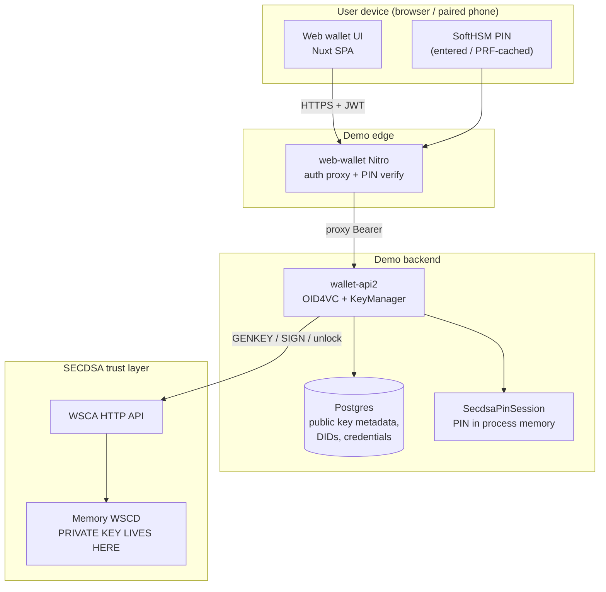
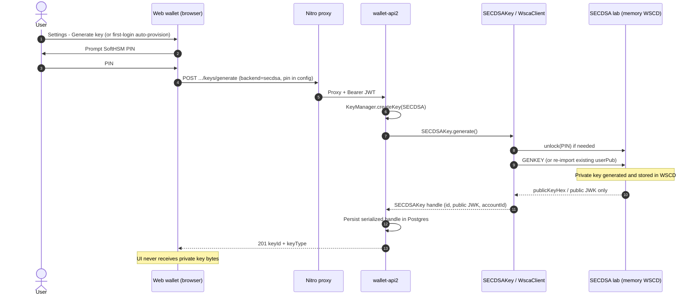
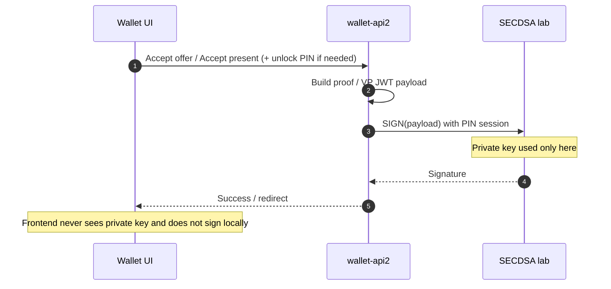
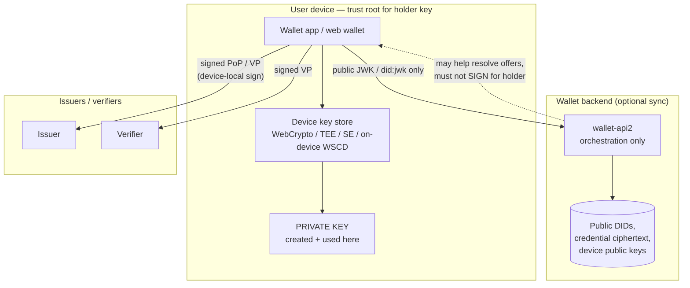
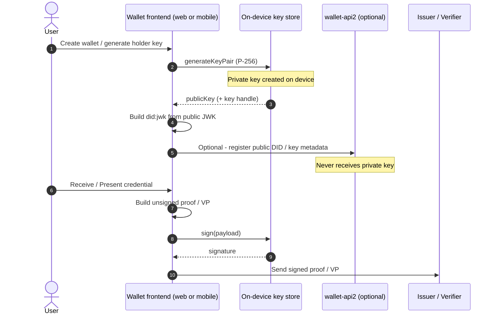
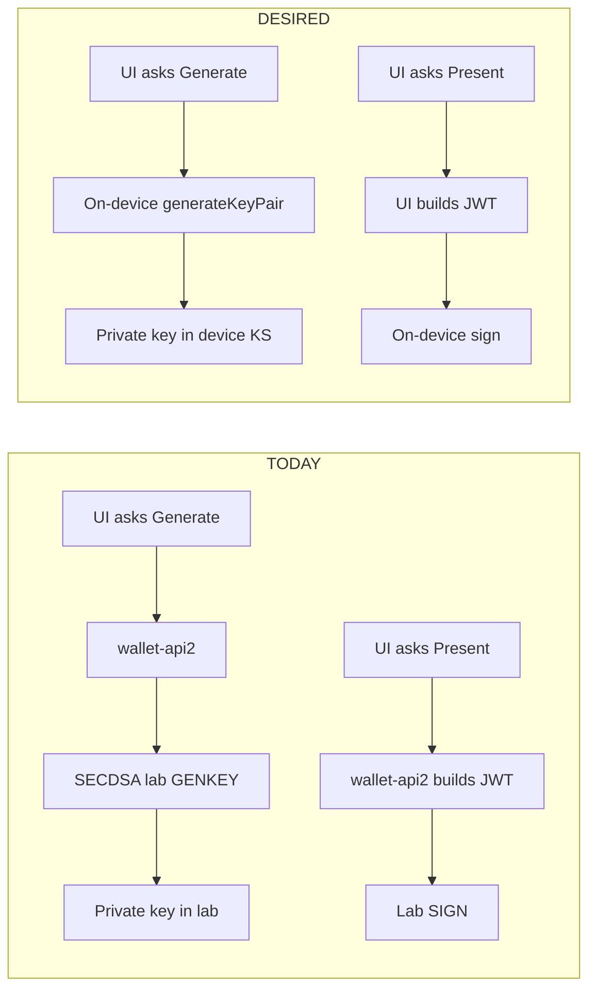

# Where the holder private key is created

**Audience:** architecture / crypto specialists reviewing this SECDSA + walt.id demo  
**Status:** educational PoC — not a production EUDI wallet  
**Date:** 2026-09-08

---

## Short answer

| Question | Answer |
|----------|--------|
| Where is the **private key** created today? | Inside the **SECDSA lab** process (`secdsa` Docker service), on **GENKEY**. |
| Is it created in the **wallet frontend** (browser / mobile)? | **No.** |
| Does the frontend ever hold private key bytes? | **No.** It holds a SoftHSM **PIN**, session JWT, and **public** key handles (`keyId`, public JWK). |
| Would moving key creation into the frontend be a small change? | **No.** It is a **radical redesign** of trust boundaries, signing path, and the SECDSA adapter model. |

For true end-to-end (“two-way”) holder binding — where only the user’s device can produce signatures that prove control of the credential — the private key must be generated and used **on the wallet side** (web secure context / mobile secure element / WSCD), not on a remote service that signs on the user’s behalf.

This demo deliberately uses the opposite pattern: a **remote signing service** (SECDSA memory WSCD) that walt.id talks to over HTTP, modeled after walt.id’s cloud KMS keys (`AWSKeyRestAPI` / `TSEKey`).

---

## 1. What “private key creation” means here

In OID4VCI / OID4VP, the **holder key** is the asymmetric key that:

1. Is bound into the credential (`credentialSubject.id` / `cnf` / DID), and  
2. Must sign proofs (PoP at receive, VP / KB-JWT at present).

“Created” means: the **private scalar** (for secp256r1 / P-256) is generated for the first time and stored somewhere that can later run **SIGN**.

That is **not** the same as:

- Creating a walt.id **wallet** row in Postgres  
- Creating a **DID document** (`did:jwk`) — that only embeds the **public** JWK  
- Entering a SoftHSM **PIN** — that unlocks remote SIGN; it is not the private key  

---

## 2. Current architecture (as implemented)

### 2.1 Components and trust domains



**Private key material exists only in the SECDSA lab WSCD.**  
Everything else stores **public** metadata or a **PIN** that authorizes remote SIGN.

Compose naming note: the UI/docs often say “SoftHSM”; the running lab is an **in-memory WSCD** educational backend (keys wipe when the `secdsa` container restarts). That does not change *where* the key is created — only durability.

### 2.2 Exact creation path (Generate key)



Primary code anchors:

| Layer | Location | Role |
|-------|----------|------|
| UI | `web-wallet/.../settings/keys/generate.vue` | Collects PIN; `POST .../keys/generate` |
| API | `wallet-api2/.../Wallet2RouteHandler.kt` | Allows only `backend=secdsa`; `KeyManager.createKey` |
| Adapter | `secdsa-waltid-adapter/.../SECDSAKey.kt` | Remote key object; “Private material never leaves SoftHSM” |
| Client | `secdsa-waltid-adapter/.../WscaClient.kt` | `generateKey()` → GENKEY / keys HTTP |
| Lab | External image `ghcr.io/harrykodden/secdsa` | Actual keygen in WSCD |

### 2.3 What each layer stores after create

| Layer | Private key? | Typical contents |
|-------|--------------|------------------|
| Browser / mobile SPA | **No** | Session cookie/JWT, SoftHSM PIN (or PRF-wrapped PIN blob), `keyId` like `secdsa:<account>:1` |
| Nitro | **No** | Proxies; may verify PIN against lab for unlock UX |
| wallet-api2 Postgres | **No** | Serialized `SECDSAKey`: public JWK, account id, lab base URL |
| wallet-api2 process | **No** (key); **PIN yes** | Transient `SecdsaPinSession` after unlock |
| SECDSA lab WSCD | **Yes** | Private key; wiped on lab restart (memory backend) |

### 2.4 How signing works today (receive / present)



So today:

- **Confidentiality of the private key vs issuers/verifiers:** good — they only ever see the **public** key (and signatures). In JWK terms that means coordinates like `x` / `y`, never the private parameter **`d`** (the secret scalar).
- **Confidentiality of the private key vs the demo backend:** the lab holds it; **wallet-api2 can request signatures** whenever the PIN session is unlocked.
- **Holder exclusivity (“only my device can sign”):** **not** achieved. Any party that can call wallet-api2 with a valid session + unlocked PIN can cause signatures.

That last point is exactly what the specialist is worried about if the goal is two-way secure traffic controlled from the wallet endpoint.

### 2.5 Mobile in this repo

There is **no separate native key store** in this repository. A paired phone uses the **same** wallet-api2 + SECDSA lab path (device pair JWT → unlock → remote GENKEY/SIGN). Mobile does **not** create the holder private key on-device in the current design.

---

## 3. Desired architecture (“wallet-side keygen”)

### 3.1 Goal stated in plain language

> To make all traffic two-way secure, the private key should be created in the Wallet frontend (web code and mobile device).

Interpreted in wallet/OID4VC terms:

1. **Generate** the holder private key **on the user device** (WebCrypto / Secure Enclave / StrongBox / WSCD on phone).  
2. **Never send** private key bytes to wallet-api2, Nitro, issuer, or verifier.  
3. **Sign** OID4VCI proofs and OID4VP presentations **on the device**.  
4. Backend services may store **public** keys, DIDs, and encrypted credential blobs — but they cannot mint holder signatures alone.

### 3.2 Target trust domains



### 3.3 Desired key creation + sign sequence



### 3.4 What “two-way secure” buys you

| Property | Current (remote GENKEY/SIGN) | Desired (device keygen + local sign) |
|----------|------------------------------|--------------------------------------|
| Issuer/verifier never see private key | Yes | Yes |
| Demo backend cannot extract private key | Yes (lab holds it) | Yes (device holds it) |
| Demo backend cannot forge holder signatures | **No** (can SIGN while PIN unlocked) | **Yes** (no private key / no remote SIGN) |
| Compromised wallet-api2 alone | Can present as holder while unlocked | Can at most disrupt / steal *public* data / credentials ciphertext |
| Compromised browser XSS | Can trigger remote SIGN with PIN/session | Can use in-page WebCrypto keys **if** they are software-exportable; hardware-backed keys resist extraction |
| Fits “wallet is the endpoint of trust” narrative | Weak (backend is co-signer) | Strong |

---

## 4. Current vs desired — side by side



| Topic | Current demo | Desired design |
|-------|--------------|----------------|
| Key creation site | SECDSA lab (server-side WSCD) | Wallet frontend / mobile secure store |
| Signing site | SECDSA lab via `WscaClient.sign` | Same device that holds the key |
| wallet-api2 role | KeyManager owner + remote signer client | Protocol orchestrator / sync server (optional) |
| SECDSA role | **Holder KMS** | Optional: PIN protocols, attestation, *not* the holder private key vault for this goal — or SECDSA runs **on device** |
| PIN meaning | Unlock remote SIGN | Unlock local key use (or WebAuthn / biometrics) |
| Postgres | Public key handles | Same + maybe encrypted backups of device keys (advanced) |
| Radical change? | — | **Yes** |

---

## 5. Why this is a radical change (impact map)

Moving keygen into the frontend is not a config toggle. It cuts across the current SECDSA-as-KMS design.

### 5.1 Components that would need redesign

| Area | Today | Required change |
|------|-------|-----------------|
| `SECDSAKey` adapter | Remote GENKEY/SIGN | Either remove as holder key backend, or reframe SECDSA as **on-device** WSCD only |
| `KeyManager.createKey(backend=secdsa)` | Server creates remote key | Device creates key; server may only **import public** metadata |
| OID4VCI receive in wallet-api2 | Server builds + signs PoP JWT | Device signs PoP; API2 may assemble offer metadata only — or move entire receive client into the SPA/native app |
| OID4VP present | Server builds + signs VP | Device signs VP / KB-JWT |
| PIN / unlock routes | Unlock server-side WSCA session | Unlock local key / WebAuthn gate |
| Mobile pairing | Phone borrows web session to hit same remote KMS | Phone generates **its own** keys (or shared via secure channel — hard) |
| SoftHSM wipe / restart footguns | Lab memory wipe orphans Postgres DIDs | Device wipe still orphans credentials — but backend restart does **not** destroy holder keys |
| Threat model docs / privacy help | “Private keys never leave SoftHSM” | “Private keys never leave the device” |

### 5.2 Design forks (product choices)

Even after agreeing “key on device”, several incompatible variants exist:

1. **WebCrypto in the browser (software)**  
   - Easy PoC; private key in JS-accessible CryptoKey (non-extractable possible).  
   - XSS / malicious extension risk remains significant.

2. **WebAuthn / passkey-bound keys**  
   - Stronger user presence; awkward fit for arbitrary OID4VP JWT signing (PRF / largeBlob / custom extensions — ecosystem still evolving).

3. **Native mobile wallet + TEE / SE**  
   - Closest to EUDI wallet expectations; requires a real mobile app, not only this Nuxt SPA.

4. **On-device SECDSA / SoftHSM**  
   - Keeps SECDSA crypto properties, but moves the WSCD into the phone — not the Compose `secdsa` service signing for everyone.

5. **Hybrid (not recommended for the stated goal)**  
   - Device generates key, then **uploads private key** to lab — defeats the specialist’s requirement.

The specialist’s requirement rules out (5) and today’s remote GENKEY model.

---

## 6. Honest assessment of the current demo

This repo is a **lab wiring** of walt.id wallet-api2 + a remote SECDSA signer so that OID4VC flows can be demonstrated end-to-end.

It already achieves:

- Private key **not** in Postgres  
- Private key **not** returned to the browser  
- Issuers/verifiers only see public keys and signatures  

It does **not** achieve:

- “The wallet frontend is where the private key is born”  
- “Only the user’s device can produce holder signatures”  
- Production-grade two-way secure holder endpoint semantics  

Those are **different security goals**. Confusing them is easy because both can truthfully say “private keys never leave SoftHSM/WSCD” — but **whose** SoftHSM/WSCD matters.

```text
Current slogan:  Private key never leaves the SECDSA lab.
Desired slogan:  Private key never leaves the user's wallet device.
```

---

## 7. Suggested next steps (if pursuing the desired model)

**Track A (cloud / WP HSM sole-control) — preferred near-term path:** contracts and
flag are in [`docs/sole-control-track-a.md`](sole-control-track-a.md); phased
checklist in local [`TODO.md`](../TODO.md) **P3-SC**. Env: `SOLE_CONTROL_SIGNING`
(default off). Next: G1 enforce grants on SIGN.

**Track B (on-device keygen) — later:**

1. **Write down the non-negotiables** with the specialist: web-only vs mobile-first; WebCrypto vs TEE; whether wallet-api2 may still see plaintext credentials.  
2. **Spike device-local P-256**: generate in browser WebCrypto (non-extractable), create `did:jwk`, sign a detached JWS, verify with walt.id policies.  
3. **Decide receive/present ownership**: keep thin API2 vs move OID4VC client fully into the frontend (larger Nuxt/native effort).  
4. **Reposition SECDSA**: on-device lab vs retire remote holder KMS for this product track.  
5. **Update threat model / privacy help** once the new boundary is chosen — do not claim EUDI LoA High without a certified WSCD path.

Until Track A G0–G3 land, treat remote GENKEY/SIGN with a cached PIN session as an
**intentional PoC shortcut**, not as the target production key architecture.

---

## 8. Reference map (code & docs)

| Topic | Path |
|-------|------|
| UI generate | `web-wallet/apps/waltid-dev-wallet/src/pages/wallet/[wallet]/settings/keys/generate.vue` |
| API generate | `wallet-api2/src/main/kotlin/id/walt/wallet2/server/handlers/Wallet2RouteHandler.kt` |
| Remote key type | `secdsa-waltid-adapter/src/main/kotlin/nl/harrykodden/secdsa/waltid/key/SECDSAKey.kt` |
| GENKEY/SIGN HTTP | `secdsa-waltid-adapter/src/main/kotlin/nl/harrykodden/secdsa/waltid/client/WscaClient.kt` |
| Privacy table | `web-wallet/.../content/help/privacy.md` |
| Stack overview | `README.md` |
| Adapter design notes | `secdsa-waltid-adapter/docs/ADAPTER.md`, `WALTID_ADAPTER_PLAN.md` |

---

## 9. One-page verdict for the specialist

**Today:** The holder private key is created in the **SECDSA lab (server-side memory WSCD)** when wallet-api2 runs GENKEY. The wallet frontend only supplies a PIN and receives a public `keyId`. Signing is **remote**. That is **not** wallet-frontend key creation.

**Desired:** Create and use the private key **in the web/mobile wallet**. That requires redesigning key generation, proof/VP signing, and likely the role of SECDSA and wallet-api2. It is the right direction for two-way secure holder traffic — and it is a **radical** change from this demo’s current remote-KMS design.
